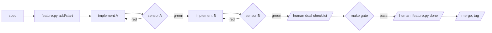

# Mobile AI Harness (dual-native, v2.1)

A ready-to-use, portable engineering harness for building a **native iOS + Android** app with AI coding agents
(Claude Code, Codex, Cursor, OpenCode, Gemini/Antigravity). Two native codebases, one product, coordinated by shared
specs, rules, sensors and a human-gated definition of done.

It ships with a **default stack, architecture and conventions per platform** so you can start immediately.
**Every default can be changed**: see [`docs/customizing.md`](docs/customizing.md).

> Reference implementation: the Leafly case study, <https://github.com/raulferrer-ai/leafly>.

## Why a harness
Agents fail in real mobile codebases for predictable reasons: bloated instructions, tool lock-in, changes nobody
verified, lost session state, and "done" that only means "the agent said so". The harness answers each one:

| Problem | Mechanism |
| --- | --- |
| Context bloat and rule drift | Lean `AGENTS.md` contracts with line budgets; skills loaded on demand; details in references |
| Tool lock-in, symlink pain | Plain-text pointers (`CLAUDE.md`, `GEMINI.md`), native `AGENTS.md`, thin adapters, zero symlinks |
| Unverified changes | **Sensors** (tests/build) run by script; the board records green itself |
| "Declared done" | **Gate** + **human-only close**: a state machine refuses unearned transitions |
| Lost state between sessions | `progress/current.md` handoff notes + `feature_list.json` + `make status` |
| Same mistake repeatedly | **Flywheel**: failure -> log -> rule/spec/sensor |
| Silent decisions | Defaults are explicit; changes need an ADR (`docs/decisions/`) |

## Quick start
```bash
git clone <this repo> my-app && cd my-app
sh init.sh                       # creates missing state files, validates, prints status
$EDITOR harness.env              # project name, Xcode project path/scheme, simulator
$EDITOR docs/product.md docs/design-system.md
# create the native projects under ios/ and android/ (see docs/stack.md for the baseline)
# write the first spec, register it, start it:
cp features/00-template.feature features/01-my-feature.feature   # then edit; delete the template marker
python3 scripts/feature.py add my-feature "My feature" --spec features/01-my-feature.feature
python3 scripts/feature.py start my-feature
```
Then open your agent in the repo root and say: *"Follow AGENTS.md. Plan and implement the active feature on iOS."*

## Layout
```text
.
├── AGENTS.md  CLAUDE.md  GEMINI.md        root contract + plain-text pointers
├── ios/AGENTS.md  android/AGENTS.md       platform contracts (stack defaults, rules)
├── harness.env                            the single configuration file
├── feature_list.json  features/           board (state machine) + Gherkin specs
├── progress/                              current.md (session), log.md, flywheel-log.md
├── docs/                                  architecture, stack, customizing, bootstrap, workflow, flywheel, design system,
│                                          parity matrix, product brief, dual checklist, security, privacy-compliance,
│                                          ai-governance, decisions/ (ADRs)
├── templates/sample-feature/              reference slice (spec + iOS/Android code and tests) to prove the loop
├── SECURITY.md  CONTRIBUTING.md  .github/CODEOWNERS  .github/dependabot.yml
├── .agents/skills/ (14)  .agents/references/  .agents/hooks/
├── .claude/ .opencode/ .codex/ .cursor/   thin tool adapters
├── scripts/                               feature.py, sensor.sh, verify-feature.sh, validate-harness.py, tests/
├── .github/                               CI workflow + PR template
└── Makefile  init.sh  .gitignore  .gitattributes  .editorconfig  .aiexclude  .cursorignore
```

## How a feature flows

Details and routes: [`docs/workflow.md`](docs/workflow.md).

## Default stack (summary)
| | iOS | Android |
| --- | --- | --- |
| Language / UI | Swift 6, SwiftUI | Kotlin 2.4.x, Jetpack Compose + Material 3 |
| State | `@Observable` view models | `ViewModel` + `StateFlow`, UDF |
| Persistence | SwiftData | Room 3 (+ DataStore) |
| Async | async/await | Coroutines + Flow |
| DI | Constructor injection, composition root | Manual `AppContainer` |
| Tests | Swift Testing + XCUITest | JUnit + Turbine + Compose tests |

Full tables, alternatives and the **verified version baseline**: [`docs/stack.md`](docs/stack.md).

## Commands
`make help` lists all. Most used: `make status`, `make sensor-ios`, `make sensor-android`, `make gate`,
`make validate-harness`, `make test-harness`, `make doctor`, `make scan-secrets`. Board: `python3 scripts/feature.py --help`.

## Tool support
| Tool | Reads | Adapter |
| --- | --- | --- |
| Claude Code | `CLAUDE.md` -> `AGENTS.md` | `.claude/settings.json` (permissions + hooks) |
| Codex | `AGENTS.md` | `.codex/config.toml` |
| OpenCode | `AGENTS.md` | `.opencode/opencode.json` |
| Cursor | `AGENTS.md` | `.cursor/hooks.json`, `.cursorignore` |
| Gemini / Antigravity | `GEMINI.md` -> `AGENTS.md` | `.aiexclude` |

## Safety model (and its limits)
Hooks and permission rules block common accidents (destructive commands, secrets, hand-editing the board, closing a
feature). They are **guardrails, not a security boundary**: an agent with shell access can still do harm. The real
backstops are `make validate-harness` (also in CI), which re-checks the board invariants, and code review.

## Verification and CI
GitHub Actions runs the harness validation and its unit tests, the Android sensor (if `android/gradlew` exists) and an
iOS build on macOS (if the Xcode project exists). To run iOS tests in CI, see the comment in `.github/workflows/ci.yml`.

## Readiness and scope (honest status)
| Area | Status |
| --- | --- |
| Harness scripts, board, hooks, validator, secret scan | Implemented and covered by unit tests (`make test-harness`) |
| Native build (Xcode/Gradle), sensors on real projects, reference slice | **Not compiled by the template**; verify with `docs/bootstrap.md` step 4 on your toolchain |
| Security, privacy, AI governance | Templates and checklists to be completed and approved by your owners; not legal advice |
| Release pipeline, environments, feature flags, crash reporting, tracker integration | Not included (planned v3) |
| Out of scope by design | Cross-platform UI frameworks (Flutter, React Native, KMP UI), games |

Enterprise adoption checklist: `docs/bootstrap.md`, section 6.

## Versioning
See [`CHANGELOG.md`](CHANGELOG.md) for what changed in v2 and how to migrate from v1 or from Leafly.
