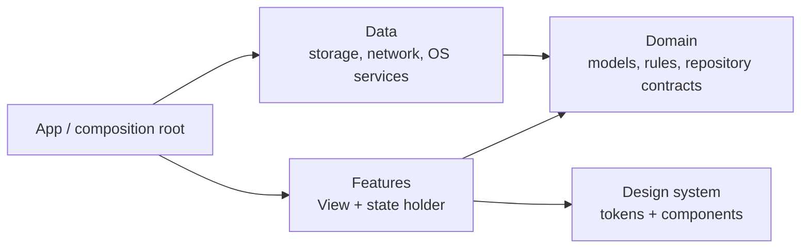

# Architecture

Shared principles for both platforms. Platform specifics: `ios/AGENTS.md`, `android/AGENTS.md`,
`.agents/references/ios-stack.md`, `.agents/references/android-stack.md`. The default technologies are in `docs/stack.md`.

## Principles
- **Two native codebases, one product.** We share *knowledge* (specs, domain rules, design language), not UI code.
- **Layered and testable.** Dependencies point inward: features depend on domain; data depends on domain; domain depends on nothing.
- **Local-first by default.** The local store is the single source of truth for the UI. Network (if any) syncs into it.
- **Unidirectional data flow.** UI renders state and emits events; only the state holder mutates state.
- **Explicit errors and states.** Every screen models loading, empty, content and error. No silent failures.
- **Deterministic logic.** Time, randomness and IDs are injected so business rules are unit-testable.

## Layers

| Layer | iOS | Android | Contains |
| --- | --- | --- | --- |
| App / composition root | `App/` | `AppContainer`, `Application`, `MainActivity` | Wiring, root navigation, process-level setup |
| Features | `Features/<Feature>/` | `features/<feature>/` | Screen, state holder, UI state, feature-only components |
| Domain | `Domain/` | `domain/` | Models, repository contracts, pure services/use cases, business rules |
| Data | `Data/` | `data/` | Persistence, mapping, network, notifications, media, OS adapters |
| Design system | `DesignSystem/` | `designsystem/` | Tokens, theme, reusable components |

## Rules that hold on both platforms
1. **Domain is pure.** No UI framework, no persistence framework, no OS APIs.
2. **Map at the boundary.** Storage entities and DTOs never leave `Data/`; repositories return domain models.
3. **Business rules live in domain**, not in views, composables, DAOs or view models.
4. **Use cases only when they add clarity** (orchestration across repositories, reused rules). A pass-through use case is noise.
5. **State holders** (view model) own presentation state, translate errors to user-facing messages and call domain/repositories.
6. **Dependency injection by constructor.** One composition root builds the graph. No service locators or global singletons.
7. **OS capabilities behind interfaces** (notifications, camera/photos, clock, permissions) so they can be faked in tests.
8. **Errors:** repositories throw/return typed errors; the state holder maps them to calm messages; never swallow.
9. **Navigation** is owned by the root/feature layer; domain and data know nothing about screens.
10. **Privacy:** no personal data in logs; secrets never in the repo (see skill `mobile-security-privacy`).

## Growth path
Start single-module per platform. Split into modules (feature/data/designsystem) only when build times, team size or
ownership demand it, and record it in `docs/decisions/`. Introduce a network/sync layer behind the existing repository
contracts so features do not change.

## Parity
Same behaviour and tone on both platforms, native idioms for the rest. Intentional differences are logged in
`docs/parity-matrix.md`.
