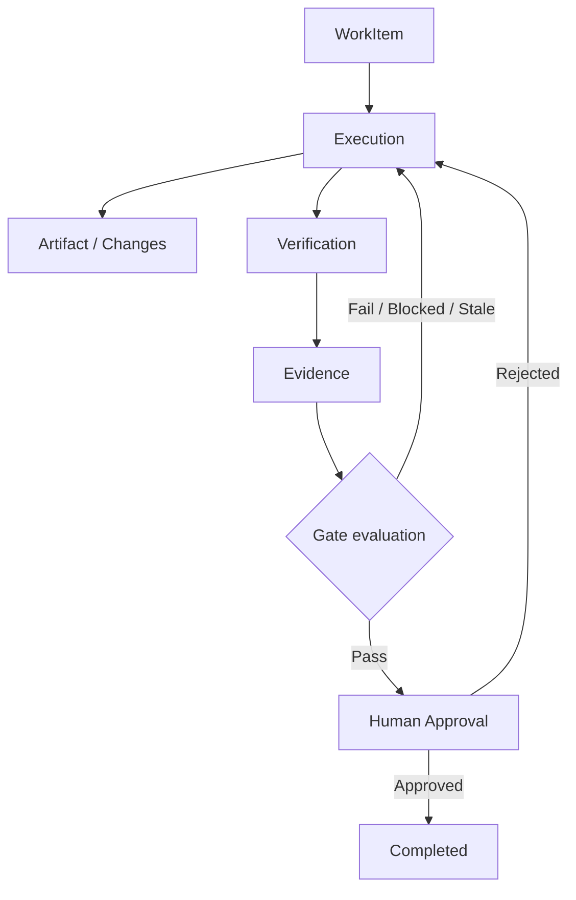

# Engineering Core — Domain Model

## 1. Purpose

This document defines the tool-agnostic domain model for the Engineering Core: the minimum set of concepts and invariants required to coordinate agent-assisted software work, verify its outcomes, enforce quality gates, and preserve human accountability.

The Core describes **engineering workflow and control**, not a particular programming language, platform, framework, repository layout, or AI agent.

The first reference implementation is dual-native mobile development (iOS and Android). Platform- and stack-specific requirements belong in Engineering Profiles and project configuration, not in this domain model.

## 2. Design principles

1. **Evidence over declarations.** An agent's statement that a check passed is not proof that it passed.
2. **Verification is independent of implementation.** A successful result must be produced or validated by an authorized verification mechanism.
3. **Evidence is bound to the exact subject verified.** A result without an identifiable source snapshot cannot satisfy a Gate.
4. **State transitions are controlled.** Work cannot advance merely because an agent edits a status field.
5. **Human accountability is explicit.** Passing automated checks does not authorize completion, merge, or release.
6. **History is preserved.** New attempts and results append to the record; they do not erase earlier outcomes.
7. **The Core stays small.** Tool, agent, platform, and project specifics are supplied by adapters, profiles, or extensions.

## 3. Core entities

| Entity | Responsibility |
| --- | --- |
| **WorkItem** | Defines a unit of work, its intent, scope, and acceptance criteria. |
| **Execution** | Records one concrete attempt to perform a WorkItem. |
| **Artifact** | Identifies outputs or changes produced by an Execution. |
| **Verification** | Records a check performed against identified artifacts and a source snapshot. |
| **Evidence** | Immutable, machine-verifiable record supporting a Verification result. |
| **Gate** | Evaluates whether the required policy conditions are satisfied by current evidence. |
| **Approval** | Records an explicit human decision at a defined approval point. |

These are the required domain concepts, not necessarily separate files, database tables, or services. An implementation may persist them in repository files, provided it preserves the semantics and invariants defined here.

### 3.1 WorkItem

A WorkItem describes what needs to be changed or achieved.

Minimum conceptual attributes:

- Stable identifier.
- Title and description.
- Acceptance criteria.
- Current lifecycle state.
- References to its Executions.
- Creation and update metadata.

A WorkItem may have multiple Executions. Retrying work creates a new Execution; it does not overwrite the previous attempt.

### 3.2 Execution

An Execution is one bounded attempt to implement or otherwise fulfil a WorkItem.

Minimum conceptual attributes:

- Stable identifier and WorkItem reference.
- Lifecycle state.
- Start and end timestamps.
- Initiating actor or process.
- Source snapshot identifier, when available.
- References to produced Artifacts, Verifications, and Evidence.

An Execution records what happened during an attempt. It is not itself proof of correctness.

### 3.3 Artifact

An Artifact is an identifiable output of an Execution. It may be a source-code change, generated file, build output, test report, package, or other relevant result.

Artifacts should be referenced by stable identifiers or content digests where practical. The Core does not prescribe a storage system.

A source change is not adequately identified by a branch name alone: a branch can move. Verification must refer to an immutable commit or to a reproducible snapshot of the exact working-tree contents that were checked.

### 3.4 Verification

A Verification is a check performed by an authorized verifier against explicitly identified inputs.

Examples include:

- Unit or integration tests.
- Compilation or build checks.
- Static analysis and linting.
- Security or dependency checks.
- Profile-defined acceptance checks.

Minimum conceptual attributes:

- Stable identifier.
- Verification type or policy identifier.
- Verifier identity and version.
- Target Artifact(s) and source snapshot.
- Execution time.
- Outcome.
- References to the resulting Evidence.

An agent may request a Verification or provide context for it. An agent's self-reported success is not an authoritative Verification result.

### 3.5 Evidence

Evidence is the immutable record produced by, or obtained through, an authorized Verification.

At minimum, Evidence identifies:

- The Verification that produced it.
- The exact source snapshot or revision verified.
- The verifier and verifier version.
- The check or command executed, including relevant parameters.
- The execution time.
- The process exit code or equivalent structured outcome.
- The result and references to relevant logs or output artifacts.

Implementations should additionally capture relevant environment and toolchain identity, policy/configuration versions, and content digests for output artifacts.

Evidence is append-only. A later run creates new Evidence; it does not modify the record of an earlier run.

**A declaration, manually supplied status, screenshot, or agent-authored report is not sufficient Evidence by itself.** Such material may be retained as supporting information, but cannot satisfy a Gate unless an authorized verifier independently validates it.

### 3.6 Gate

A Gate evaluates a set of policy requirements against Evidence relevant to a WorkItem and its current source snapshot.

A Gate evaluation must record:

- Stable identifier.
- WorkItem and relevant Execution references.
- Policy identifier and version.
- Source snapshot evaluated.
- Evidence considered.
- Per-requirement outcomes and overall result.
- Evaluation time.

A Gate is a decision derived from Evidence and policy. It must not trust an agent-provided list of green statuses as proof that the underlying checks ran.

A Gate result applies only to the exact source snapshot and policy version it evaluated. If either changes in a way relevant to the Gate, the result must be reevaluated.

### 3.7 Approval

An Approval is an explicit decision by an authorized human at a defined workflow suspend point.

It records:

- The WorkItem and approval point.
- The human approver's identity.
- Decision: approved or rejected.
- Timestamp.
- The Gate and source snapshot being approved.
- Optional rationale or comments.

Approval is separate from Gate evaluation. A passing Gate never implies human approval.

## 4. Lifecycle states

States are domain concepts. An implementation may use different labels, but must preserve equivalent transition constraints.

### 4.1 WorkItem

`draft → ready → in_progress → awaiting_approval → completed`

Additional transitions:

- `in_progress → blocked`
- `blocked → in_progress`
- `awaiting_approval → in_progress` when approval is rejected or changes are requested.
- A non-completed WorkItem may transition to `cancelled` under the applicable policy.

A WorkItem can enter `awaiting_approval` only when its required Gate has passed. It can enter `completed` only after the required human Approval has been recorded against that Gate and source snapshot.

### 4.2 Execution

`created → running → succeeded | failed | interrupted`

Each retry is a new Execution. Terminal Executions are not reopened or rewritten; a new attempt is created instead.

An Execution marked `succeeded` means the attempt completed according to its execution protocol. It does not mean the WorkItem passed its Gate.

### 4.3 Verification

`pending → passed | failed | inconclusive | skipped`

- `passed`: the authorized check completed and satisfied its defined condition.
- `failed`: the check completed and did not satisfy its condition.
- `inconclusive`: the check could not establish either outcome.
- `skipped`: the check was not performed.

`skipped` and `inconclusive` are never equivalent to `passed`. A required Verification in either state cannot satisfy its Gate requirement.

### 4.4 Gate

`not_evaluated → passed | failed | blocked | stale`

- `passed`: all required policy conditions are supported by valid Evidence.
- `failed`: one or more evaluated requirements failed.
- `blocked`: evaluation could not be completed, for example because required Evidence or a verifier was unavailable.
- `stale`: the source snapshot or relevant policy has changed since evaluation, so the previous result is no longer current.

A new evaluation creates a new Gate result or evaluation record. Historical results remain available for audit.

## 5. Relationships

- A WorkItem has one or more Executions.
- An Execution produces zero or more Artifacts.
- An Execution may initiate one or more Verifications.
- A Verification produces one or more Evidence records, as appropriate to the check.
- A Gate evaluates Evidence against a policy for a WorkItem and a specific source snapshot.
- An Approval refers to a WorkItem and the exact Gate result and source snapshot it approves.

Conceptually:

## 6. Source snapshot and evidence validity

Evidence is useful only if the system can establish what was checked.

The source snapshot must be immutable and unambiguous:

- Prefer a Git commit SHA when the verified tree is exactly represented by that commit.
- If verification runs against uncommitted changes, identify the complete relevant working-tree snapshot using a deterministic content digest or an equivalent mechanism. Record relevant untracked files and changes; a commit SHA alone is insufficient.
- A branch name, tag name, or mutable path is not a source snapshot identifier.
- Record submodule and external dependency revisions when they materially affect reproducibility.

A Gate evaluation must compare the snapshot it evaluates with the snapshot to which the Evidence applies. Evidence from a different snapshot cannot be silently reused.

Any relevant source change after verification makes the prior Gate stale for the changed source. The implementation must require the affected verifications and Gate to run again. Policy changes that alter required checks or their interpretation likewise invalidate the affected Gate.

The Core does not mandate a particular hashing algorithm or Git workflow. The implementation must, however, use a collision-resistant digest and a documented snapshot procedure if content hashing is used.

## 7. Domain invariants

Every conforming implementation must preserve these invariants:

1. **Authorized verification:** only an authorized verifier can produce an authoritative Verification outcome.
2. **No self-certification:** an agent cannot make its own assertion count as passed Evidence.
3. **Evidence immutability:** Evidence is append-only; corrections or reruns produce new records.
4. **Snapshot binding:** every Gate-relevant Evidence record identifies the exact source snapshot it verifies.
5. **Freshness:** Evidence from another snapshot, or from an obsolete relevant policy version, cannot satisfy the current Gate.
6. **Gate integrity:** a Gate evaluates actual Evidence and policy; it does not trust manually supplied green flags.
7. **Approval separation:** Gate passage and human Approval are independent requirements.
8. **Authorized closure:** only an authorized human can approve completion where the workflow requires human approval.
9. **Approval binding:** completion is tied to the exact passing Gate result and source snapshot approved by the human.
10. **Valid transitions:** state changes occur only through permitted transitions and authorized operations.
11. **History preservation:** retries and reevaluations preserve prior Executions, Verifications, Evidence, Gate results, and Approvals.
12. **No implicit success:** missing, skipped, unavailable, or inconclusive required checks never count as passed.

## 8. Trust boundaries and responsibilities

The Core distinguishes responsibilities even when an implementation runs them in the same process:

| Actor / mechanism | May do | Must not do |
| --- | --- | --- |
| Agent | Propose plans and changes; create or update work through approved commands; request checks; provide diagnostic context | Declare authoritative Verification outcomes, forge Evidence, bypass Gate policy, or approve its own completion |
| Execution runner | Start and record bounded executions; capture outputs and source identity | Treat an agent's claim as a successful check |
| Authorized verifier | Execute or independently validate a defined check and emit Evidence | Report success without validating the identified inputs |
| Gate evaluator | Evaluate current Evidence against a versioned policy | Trust mutable status flags or stale Evidence |
| Authorized human | Review results; approve or reject defined suspend points | Approve a different source snapshot from the one reviewed without triggering reevaluation |

Hooks and agent instructions are useful guardrails, but they are not by themselves a security boundary. The trusted path for verification, Evidence creation, Gate evaluation, and human approval must be enforced by mechanisms the agent cannot trivially rewrite or invoke to fabricate success. Stronger deployments should protect these mechanisms through permissions, isolated runners, signed records, CI identity, or equivalent controls.

## 9. Persistence and implementation neutrality

The domain model does not require a database, central server, GUI, or particular serialization format.

A repository-based implementation may persist records in version-controlled or generated files. Regardless of storage choice, it must preserve:

- Stable identifiers and explicit relationships.
- Append-only execution and verification history.
- Source-snapshot binding.
- Authorized creation of Evidence and Gate results.
- Validated state transitions.
- Human approval records and their scope.

Adapters may translate tool-specific events into Core operations. Engineering Profiles may define required verifications, acceptance policies, platform matrices, and project conventions. Neither should redefine the Core invariants.

## 10. Mapping from the current Mobile AI Harness

The current harness provides useful implementation concepts, but the mapping is not one-to-one in every case:

| Current harness concept | Engineering Core concept |
| --- | --- |
| Feature specification and board entry | WorkItem |
| `feature.py start` | WorkItem transition and Execution creation |
| Agent implementation session | Execution |
| Source changes and build outputs | Artifact |
| Sensor invocation | Verification |
| Sensor output and recorded result | Evidence |
| `make gate` | Gate evaluation |
| Human checklist and close command | Approval and WorkItem completion |
| `feature_list.json` | One possible persistence mechanism for Core state |

The current sensor and board mechanisms are an implementation baseline, not proof that all Core invariants are already enforced. In particular, a sensor result must be made trustworthy and bound to the exact source snapshot before it can count as Gate Evidence.

## 11. Out of scope

The following are intentionally not required Core entities at this stage:

- Agent or model identity as a first-class domain entity.
- Tool or adapter identity as a first-class domain entity.
- Project, repository, platform, or programming language.
- Task scheduling, agent orchestration topology, or concurrency strategy.
- User interface, central service, or database schema.

Implementations may attach this information as metadata or introduce profile-specific extensions where it adds operational value. It must not make the Core dependent on a particular vendor or technology stack.
