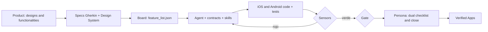

# 03 - How it Works

## 1. Overall View



## 2. What the Agent Reads and in What Order

At the start of a session, the agent (or the person directing it) always follows the same protocol, defined in `AGENTS.md`:

1. Read `progress/current.md` (what the previous session was doing) and run `make status`.
2. Read the active feature's spec and the platform contract you're going to work on.
3. Load only the necessary skills (index in `.agents/skills/README.md`).
4. Follow the graph of `docs/workflow.md`, without skipping steps.
5. Before finishing, update `progress/current.md` and `progress/log.md`.

The `CLAUDE.md` and `GEMINI.md` files are pointers that refer to `AGENTS.md`. Tools that read `AGENTS.md` natively (Codex, OpenCode, Cursor) don't need a pointer.

## 3. Feature Life Cycle

| Step | Who | Action | What changes in the repository |
| --- | --- | --- | --- |
| 1 | Person + agent (skill `feature-spec-writer`) | Write the spec | New `features/NN-<id>.feature` |
| 2 | Person or agent | `python3 scripts/feature.py add ...` | `planned` entry in `feature_list.json` |
| 3 | Person or agent | `python3 scripts/feature.py start <id>` | `in_progress` state (only one at a time) |
| 4 | Agent (skill `workflow-planner`) | Plan | Plan in `progress/current.md` |
| 5 | Agent | Implement in platform A | Code and tests of platform A |
| 6 | Script | `make sensor-ios` or `make sensor-android` | Platform A goes to `sensor_green` (or back to `in_progress` if it fails) |
| 7 | Agent | Implement in platform B and repeat the sensor | Platform B in `sensor_green` |
| 8 | Person | Dual checklist (`docs/dual-checklist.md`) | Evidence in the PR |
| 9 | Script | `make gate` | Gate registration in the feature |
| 10 | Person | `python3 scripts/feature.py done <id> --human-checklist-ok` | `done` state, `verified: true` |
| 11 | Person | Commit, PR, merge | Git history |

Rules the system imposes:

- A sensor in red invalidates the previous gate. An old gate cannot close a feature.
- A sensor not available (e.g., iOS from a Linux machine) never counts as green.
- Only the script writes `sensor_green`; the board command rejects it if attempted by hand.
- Closing without the human flag, or without a complete gate, fails.

## 4. Feature Board Data Model (`feature_list.json`)

```json
{
  "schema_version": 2,
  "project": "mi-app",
  "features": [
    {
      "id": "plant-list",
      "title": "Lista de plantas",
      "spec": "features/02-plant-list.feature",
      "status": "in_progress",
      "priority": 2,
      "platforms": { "ios": "sensor_green", "android": "in_progress" },
      "sensors": { "ios": { "at": "2026-11-27T10:00:00Z", "mode": "test" } },
      "gate": null,
      "verified": false
    }
  ]
}
```

| Field | Meaning |
| --- | --- |
| `schema_version` | Format version; must be 2 |
| `project` | Project name |
| `id` | Identifier in lowercase with hyphens |
| `title` | Readable name |
| `spec` | Spec path; must exist |
| `status` | `planned`, `in_progress`, `blocked`, `done` |
| `priority` | Execution order (smaller number, first) |
| `platforms` | State per platform; a feature can point to a subset |
| `sensors` | Last green sensor per platform, with hour and mode (`test` or `build`) |
| `gate` | Gate record (hour, sensors, degraded platforms) or `{"legacy": true}` |
| `verified` | `true` only in `done` features |
| `blocked_reason` | Reason, if it's blocked |
| `completed_at` | Close hour |

The validator (`scripts/validate-harness.py`) rechecks these invariants, so editing the JSON manually to skip the process is detected in validation and in CI.

## 5. How Scripts Connect

| Piece | Reads | Writes | Invokes |
| --- | --- | --- | --- |
| `Makefile` | `harness.env` | nothing | All scripts |
| `scripts/sensor.sh` | `harness.env` | Platform state, via `feature.py record-sensor` | `xcodebuild`, `gradlew`, `java` |
| `scripts/verify-feature.sh` | `harness.env`, board | Gate registration, via `feature.py gate` | `validate-harness.py`, `scan-secrets.py`, `audit-architecture.py`, `sensor.sh` |
| `scripts/feature.py` | `harness.env`, board, specs | `feature_list.json` | nothing |
| `scripts/validate-harness.py` | Almost entire repo | nothing | `sh -n` |
| `scripts/audit-architecture.py` | `harness.env`, source code, `.audit-baseline` | `.audit-baseline` (only with `--update-baseline`) | nothing |
| `scripts/scan-secrets.py` | Repo files, `.secrets-allowlist` | nothing | `git ls-files` |
| `init.sh` | Repo state | State files that are missing | `validate-harness.py`, `feature.py status` |

## 6. Security Model

| Layer | What it Prevents | How | Limit |
| --- | --- | --- | --- |
| Tool permissions (`.claude/settings.json`) | Read secrets, edit board by hand, close features, destructive commands | Allow/deny rules | Only in tools that support them |
| Hooks (`.agents/hooks/`) | Same risks, looking at the actual content of each command or route | Scripts that return code 2 to block | Barandillas: an agent with terminal can evade them |
| Exclusion files (`.aiexclude`, `.cursorignore`) | That IA tools index secrets and artefacts | Pattern lists | Depends on the tool respecting them |
| Secret scanner | That a key or a certificate reaches the repo | Patterns and prohibited file types | Complements, does not substitute, corporate scanning |
| Validator and CI | Anything that skips the above | Invariant rules revalidated in every PR | Requires protecting the main branch |
| `CODEOWNERS` and review | Changes to the harness without approval | Mandatory review of owners | Requires enabling branch protection |

Honest conclusion: no single layer is a security frontier by itself. Defense is the combination and, above all, human review and branch protection.

## 7. Summary of App Architecture (resumo)

Each platform follows inner-dependent layers: **Features** (screen and state) depend on **Domain** (models, rules, repository contracts); **Data** (storage, network, system services) also depend on Domain; the **Design System** is independent; the **composition root** connects everything. Detail in `docs/architecture.md`, `docs/stack.md` and platform references. The default stack is SwiftUI, SwiftData and Swift Testing in iOS, and Compose, Room and JUnit with Turbine in Android; any element can be changed following `docs/customizing.md`.
