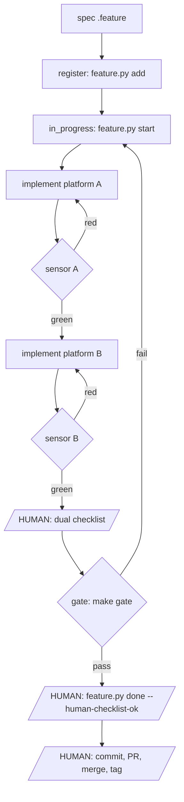

# Feature workflow (graph)

The explicit graph for how a feature moves. The Loop (build -> sensor -> fix) lives inside the platform nodes.
The gate is the last automated lock; the human closes. Rules: `AGENTS.md`. Commands: `make help`.

One platform per agent session. Platform order is a convention (say it in `progress/current.md`).

## Nodes
| Node | Meaning | Exit condition |
| --- | --- | --- |
| spec | Gherkin describes behaviour (skill: `feature-spec-writer`) | File has Feature + Scenarios, no template marker |
| register | Add to the board | `python3 scripts/feature.py add <id> "<title>" --spec <path>` |
| in_progress | The one active feature | `feature.py start <id>` (refuses a second one) |
| implement | Smallest change that satisfies the spec, with tests | Compiles; ready to measure |
| sensor | `make sensor-ios` / `make sensor-android` | Green; the sensor itself records `sensor_green` |
| dual checklist | Human compares behaviour, tone and states on both apps (`docs/dual-checklist.md`) | Accepted |
| gate | `make gate` | Passed; gate recorded on the board |
| done | Closed on the board | Human runs `feature.py done <id> --human-checklist-ok` |
| merge / tag | What ships | Human decision |

## Routes
- **Sensor red -> same implement node.** Never claim a platform is ready.
- **Any new sensor result invalidates an older gate** (the board clears it), so a stale gate cannot close a feature.
- **Gate fail or partial -> not done.** Partial means a sensor was unavailable or skipped (exit 3): fix the environment.
- **No skipping:** you cannot reach `done` without both sensors green, a recorded gate and the human step.
- **Blocked:** `feature.py block <id> --reason "..."`; resume with `start`.
- **Flywheel side path:** deviation -> fix -> `progress/flywheel-log.md` -> rule/spec/test when repeatable.

## Session protocol (continuity across sessions)
Start: read `progress/current.md`, `make status`, the spec. End: update `progress/current.md` (state, next step,
handoff notes: what you tried, what is flaky, what to do next) and append to `progress/log.md`.
A fresh agent must be able to continue from those files alone.

## Suspend points (human only)
| Suspend | Decision |
| --- | --- |
| Dual checklist | Same flows, same tone, same acceptance intent on both platforms |
| Close feature | The evidence is enough |
| Merge to main | This belongs in the default branch |
| Tag / release | This commit is a named milestone |
| Scope or stack change | Rewrite the spec / write the ADR before more code |

## Change policy
Change this graph deliberately: update this file and `AGENTS.md` in the same change set.
